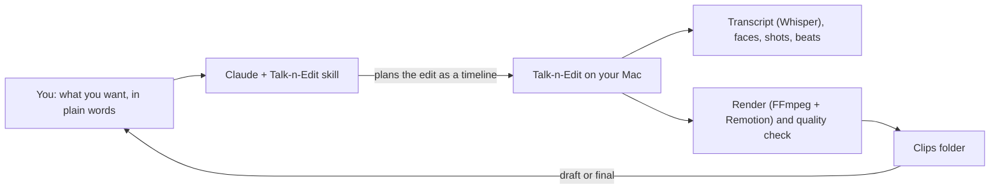

# Talk-n-Edit

**The AI video editor you talk to.** Tell Claude what you want, in plain words, and it cuts, captions and polishes your Reels, Shorts and TikToks on your own Mac.

[](https://github.com/deepak199922/talk-n-edit/actions/workflows/test.yml)


```text
You:     Make 3 Reels from the podcast in my inbox. Punchy style, Hinglish captions,
         zoom in on the big lines, and end each one with a follow button.

Claude:  Quick questions first: 9:16 at around 30 seconds each? Word-pop captions?
         Any music?  …  Here are 3 drafts. Reel 1 opens on "Nobody tells you this…"
         with a snap zoom; Reel 2 …

You:     Make the captions bigger and drop the emoji in Reel 2.

Claude:  Done. Finals are in your Clips folder.
```

No timeline to learn and no templates to fight. You direct, Claude edits, and you revise by just saying what to change.

---

## Why Talk-n-Edit

- **You direct, it edits.** Describe the Reel you want, look at the draft, ask for changes. Claude remembers the edit and changes only what you asked.
- **Anything you can describe.** Transitions, zooms on a specific word, freeze frames, colour looks, blur over a logo, picture-in-picture, sound effects, animated titles and emoji. If something isn't built in, Claude writes a custom animated graphic and shows you a preview first.
- **Your language.** Word-by-word captions in English, Hindi, Punjabi and more, including Hinglish (Hindi in Roman script) and translations.
- **Private.** Your videos never leave your Mac. Transcription, face tracking and rendering all run locally.
- **No per-video fees.** It uses the Claude app you already have. There are no credits or watermarks.
- **Safe with your files.** Originals are never changed, and Talk-n-Edit never deletes anything.

## Install

**You need:** a Mac (Apple Silicon recommended), the [Claude desktop app](https://claude.ai/download), about 6 GB of free space and an internet connection for the first setup.

**1. Paste this into Terminal** (press ⌘ Space, type *Terminal*, press Enter):

```bash
/bin/bash -c "$(curl -fsSL https://raw.githubusercontent.com/deepak199922/talk-n-edit/main/install.sh)"
```

It downloads Talk-n-Edit to `~/talk-n-edit` and sets everything up: ffmpeg, Node, the speech model and the Claude connector. If something is missing, it tells you exactly what to do. The first run takes 5–15 minutes, mostly downloads.

**2. Restart Claude.** Quit it completely (⌘Q), then open it again.

**3. Add the skill.** The skill teaches Claude how to edit well. In Claude, open **Customize → Skills → "+" → Create skill → Upload a skill** and pick `talk-n-edit-skill.zip` from your Downloads folder. The installer created it and opens Finder on it.

**4. Try it.** Drop a video into `Downloads/Talk-n-Edit/Inbox` and ask Claude:

> Make 3 Reels from the video in my Talk-n-Edit inbox.

## Things to ask for

- *"Cut this podcast into 5 Shorts, each with a strong hook. Remove the pauses."*
- *"Hype style: fast cuts, whip transitions with whooshes, word-pop captions, a 🔥 when I say the price."*
- *"Cinematic look, slow motion on the intro, blur the number plate at 0:12."*
- *"Show the product photo in a corner while I talk about it, then a follow button at the end."*
- *"Captions in Hinglish, bigger, yellow on the key words."*
- *"Make a custom animated price tag that spins in."* (You'll see a preview before it's used.)
- *"Save this as my style."* and next time: *"Use my style."*
- *"Make 3 Shorts from https://youtu.be/… — only the part from 12:30 to 18:00."*
- *"Find the most-viewed podcast clips about startups from this month and show me the top 10."*
- *"List the latest Shorts from @somechannel"* or *"Get this week's top Twitch clips from shroud."*

## What it can do

| | |
| --- | --- |
| **Cutting** | Picks clips by sentence, removes pauses, speed ramps, freeze frames, reverse, stabilise, beat-synced cuts |
| **Framing** | 16:9 → 9:16 / 1:1 / 4:5 that follows faces, split screen for two people, widescreen-film layout with the letterbox bars trimmed |
| **Captions** | Word-by-word karaoke, word-pop, clean or boxed styles; auto-emphasis; Hindi, Punjabi, Hinglish, translations; adjustable size |
| **Effects** | 22 transitions, keyframed zooms and punch-ins, 14 colour looks plus your own LUTs, blur/pixelate masks, picture-in-picture and B-roll |
| **Graphics** | Animated titles, emoji, arrows, callouts, number count-ups (₹2,00,000 style), progress bar, follow/subscribe button, confetti, checklists, plus custom graphics on request |
| **Audio** | Your music, ducked under speech automatically; 11 built-in sound effects; voice clean-up; loudness set for Instagram and YouTube (−14 LUFS) |
| **Links and discovery** | Import from a link (YouTube, Shorts, Twitch, Instagram, Vimeo, X and many more), or just part of a long video; keeps chapters and YouTube's most-replayed moments so Claude can jump to the best bits; find videos by search, channel or Twitch top clips, shown with thumbnails |
| **Quality checks** | Every final is checked for black frames, dead air, loudness, hook timing and caption placement before you get it |
| **Styles** | Clean creator, hype, cinematic, podcast, minimal, product showcase, and your own saved styles |

## How it works



Claude decides *what* the video should be: which moments, which hook, which effects. Talk-n-Edit does the heavy lifting on your Mac: transcription, face tracking, rendering and checks. Each edit is saved as a version, so "go back to the previous one" just works.

## Where your files go

| Folder | What's in it |
| --- | --- |
| `~/Downloads/Talk-n-Edit/Inbox` | Drop your videos here |
| `~/Downloads/Talk-n-Edit/Clips` | Finished videos land here |
| `~/TalkNEdit` | Working files: copies of your imports, drafts, renders, saved styles, custom graphics |
| `~/talk-n-edit` | The app itself |

Talk-n-Edit never deletes anything. Old drafts stay in `~/TalkNEdit/projects` until you remove them.

## Updating

Run the same install command again. It pulls the latest version and re-runs the setup. Then restart Claude.

## Troubleshooting

| Problem | Fix |
| --- | --- |
| Claude doesn't seem to have the tools | Quit Claude completely (⌘Q, not just closing the window) and reopen it. Still missing? Run the install command again. |
| You want a health check | Ask Claude: *"Run the Talk-n-Edit system doctor."* It lists anything that's wrong and how to fix it. |
| "ffmpeg is missing filters: subtitles" | Run `brew install ffmpeg-full`, then the install command again, then restart Claude. |
| A window asks to install "command line developer tools" | Click Install, wait for it to finish, then run the install command again. |
| The transcript is in the wrong language | Tell Claude the language: *"It's in Hindi."* It re-transcribes with that setting. |
| A link won't download | Run the install command again (it updates the downloader, since sites change often). For private, unlisted or age-restricted videos, ask Claude to *"use my Chrome sign-in"*. |
| The first transcription is slow | The speech model downloads once (about 1.6 GB). Later runs are fast. |
| Animated graphics fail | Run the install command again. It downloads the small headless browser the graphics need. |

Still stuck? [Open an issue](https://github.com/deepak199922/talk-n-edit/issues/new/choose) and paste the system doctor output.

## Uninstalling

Talk-n-Edit never deletes files, so removing it is up to you:

1. In Claude, remove the skill (**Customize → Skills**).
2. Remove the `"talk-n-edit"` entry from `~/Library/Application Support/Claude/claude_desktop_config.json` (setup left a backup copy next to it), then restart Claude.
3. Delete the folders `~/talk-n-edit` and `~/TalkNEdit`, and `~/Downloads/Talk-n-Edit` once you've kept the clips you want.
4. Optional: `brew uninstall ffmpeg-full uv`, and delete the speech model in `~/.cache/huggingface/hub`.

## FAQ

**How is this different from OpusClip and similar tools?**
Those are clip factories: upload, and the AI picks clips from templates. Talk-n-Edit is an editor you direct. You get exactly the edit you describe, revise it in plain words, and keep your videos on your own machine. If you need fully automatic bulk clipping with scheduling, a clip factory may suit you better.

**What does it cost?**
Talk-n-Edit is free and open source. It runs through your Claude app, so it uses your normal Claude plan.

**Which Claude plan do I need?**
Any plan that runs the Claude desktop app with local connectors. Uploading the skill needs a plan with Skills; see [Anthropic's help article](https://support.claude.com/en/articles/12512180-use-skills-in-claude). Without the skill, Talk-n-Edit still works, but Claude edits less skilfully.

**Can I download and edit other people's videos?**
Talk-n-Edit can download from links and find videos, but it doesn't decide what you may use: **you're responsible** for having the rights to what you download, edit and post, and for following each site's terms. Your own videos, Creative Commons videos and footage you have permission for are safe choices. Reposting other people's work can get it claimed or taken down.

**Windows? Linux?**
Not packaged yet. Linux works for developers (see below). Windows is on the roadmap.

**Can I use it with Claude Code or another MCP client?**
Yes. It's a standard MCP server. For example: `claude mcp add talk-n-edit -- node ~/talk-n-edit/dist/index.js`

## Other systems (for developers)

On Linux, install ffmpeg (with libass), Node ≥ 22.13 and [uv](https://docs.astral.sh/uv/), then:

```bash
git clone https://github.com/deepak199922/talk-n-edit.git && cd talk-n-edit
npm install && npm run build
cd python && uv venv --python 3.12 .venv && uv pip install --python .venv/bin/python -r pyproject.toml && cd ..
node dist/index.js --check      # health check
npm test                        # end-to-end tests (~10 min)
```

Then add `node /path/to/talk-n-edit/dist/index.js` to your MCP client and upload `skills/talk-n-edit` (zipped) as a skill.

More detail is in the [developer reference](docs/REFERENCE.md): every tool, the timeline format, the command line, brand kits and settings.

## Contributing

Ideas, bug reports and pull requests are welcome. Start with [CONTRIBUTING.md](CONTRIBUTING.md).

## License and credits

Talk-n-Edit is [MIT licensed](LICENSE). It builds on FFmpeg, Whisper, OpenCV, PySceneDetect, Remotion and the Model Context Protocol. See [THIRD_PARTY_NOTICES.md](THIRD_PARTY_NOTICES.md). Note: **Remotion** (used for animated graphics) is free for individuals and companies of up to 3 people; larger companies need a [Remotion company license](https://www.remotion.dev/license).
